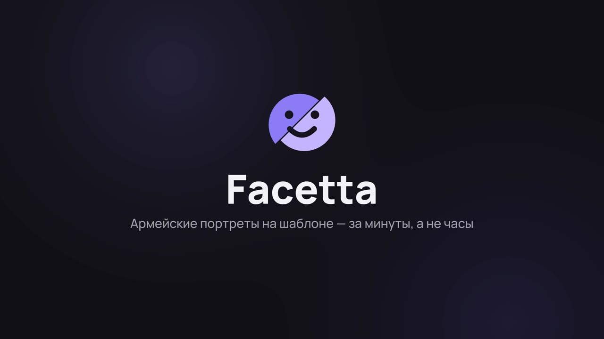
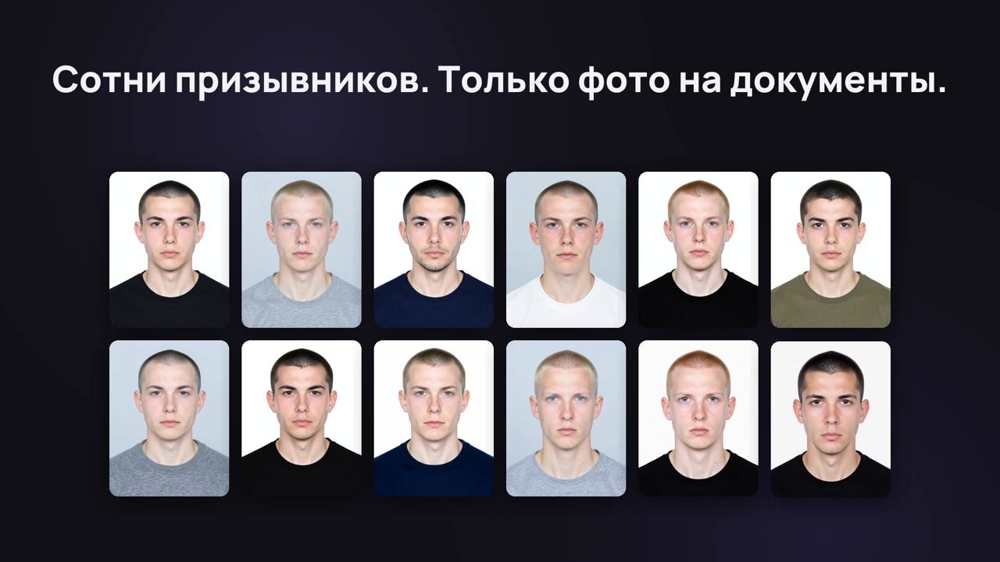
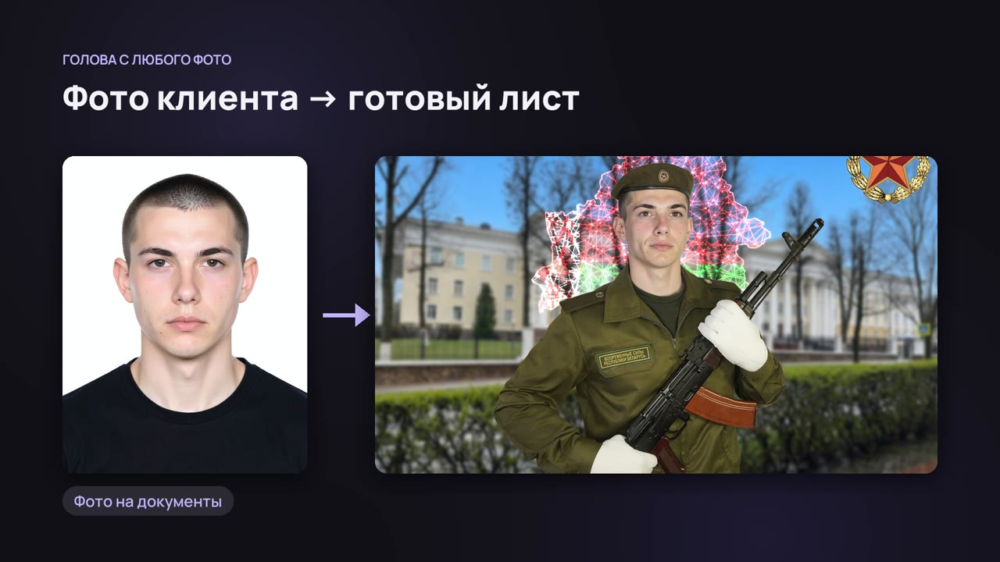
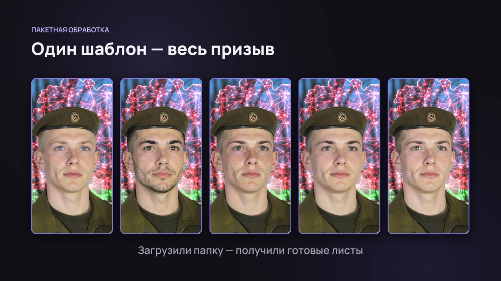
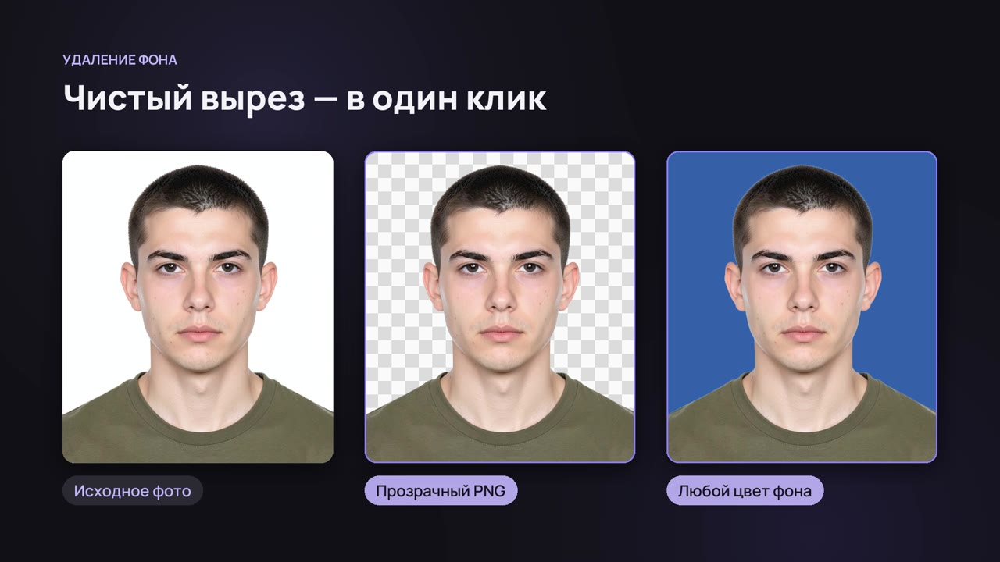
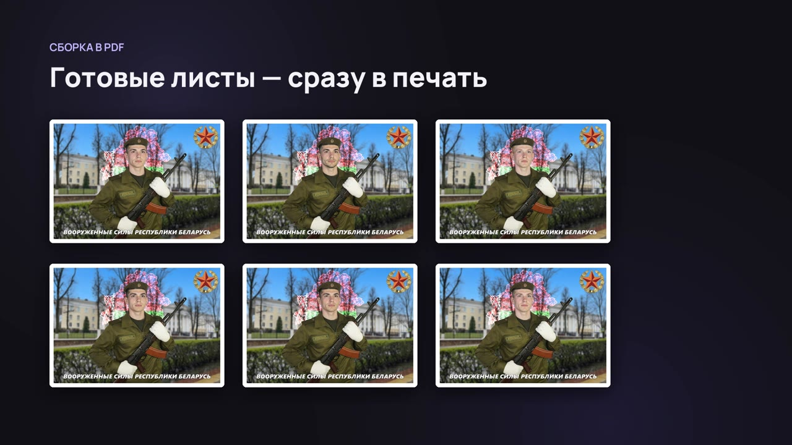
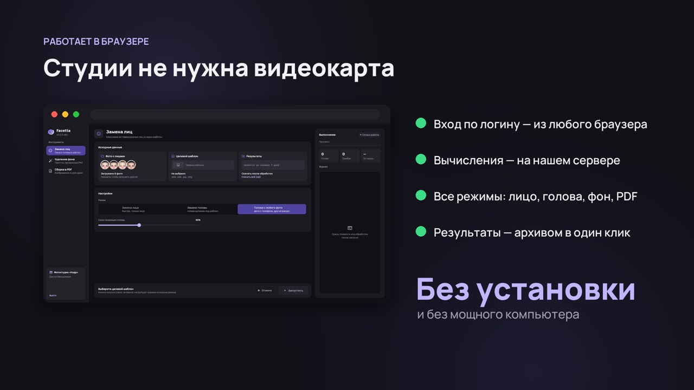

# Facetta — армейские портреты на шаблоне за минуты, а не часы

Приложение для фотостудий: из обычного фото на документы автоматически делает готовый портрет военнослужащего на шаблоне альбома и собирает листы в PDF для печати.

> Код закрытый (коммерческий проект). В этом репозитории — описание, скриншоты и демо-видео. Код и живую демонстрацию могу показать на собеседовании.

---

## Задача

Перед каждым призывом фотостудия делает сотни одинаковых портретов: лицо призывника нужно вставить в шаблон с формой и фоном. Вручную в фоторедакторе это занимает несколько минут на человека и требует ретушёра.

## Решение

Студия загружает папку с фото на документы и PSD-шаблон. Facetta сама заменяет голову, подгоняет свет и ракурс, убирает фон и раскладывает результат по листам для печати.

| | |
|---|---|
|  |  |
| **Голова с любого фото** — донор может быть снят на телефон, с другим светом и ракурсом | **Пакетная обработка** — один шаблон на весь призыв, ≈35 с на фото, сотни за ночь |
|  |  |
| **Удаление фона** — около 1,2 с на фото на видеокарте | **Сборка в PDF** — готовые листы сразу в печать |

**Веб-версия** — для студий без видеокарты: вход из браузера, обработка на сервере, оплата за фото.

---

## Как устроено

- **Обработка изображений (PyTorch, CUDA):**
  - FaceFusion — быстрая замена лица;
  - Stable Diffusion + ControlNet — голова целиком под шаблон;
  - FLUX.2 Klein + LoRA — голова с произвольного фото донора, с текстовыми поправками к генерации;
  - BiRefNet (onnxruntime) — удаление фона;
  - BiSeNet — сегментация лица и ушей для аккуратного монтажа.
- **Шаблоны:** чтение PSD (psd-tools), слой-фигура выбирается один раз и запоминается.
- **Сборка PDF:** отдельное ядро на Rust, вызывается из Python как CLI.
- **Интерфейс:** Flet, одна кодовая база для десктопа и браузера.
- **Сервер веб-версии:** FastAPI + Uvicorn. Аккаунты студий, вход через Google, тарифы и предоплаченный баланс, возвраты, очередь задач на GPU, резервные копии.
- **Telegram-бот** для частных клиентов: каталог шаблонов, приём фото, оплата и выдача результата. Работал на общем конвейере обработки, позже выведен из эксплуатации.
- **Распространение:** сборка в `.exe` (PyInstaller), офлайн-лицензии на Ed25519 с привязкой к компьютеру, автообновление через GitHub Releases с проверкой SHA-256.
- **Процесс:** GitHub Actions собирает релиз при merge в `release`, работа идёт в feature-ветках через PR. Код пишу с Claude Code и проверяю результат.

## В цифрах

- ~13,5 тыс. строк на Python + ядро на Rust
- 90+ коммитов, 30+ pull request'ов
- ≈35 с на портрет без ручной ретуши, пакетом — сотни за ночь

## Стек

Python 3.11 · PyTorch · diffusers · Stable Diffusion · ControlNet · FLUX.2 · FaceFusion · onnxruntime · OpenCV · Flet · FastAPI · Rust · PyInstaller · GitHub Actions

---

Андрей Матьянов · [GitHub](https://github.com/AndreyMatyanov)
